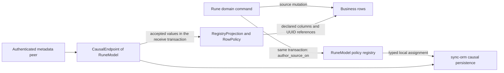

# Rune synchronization integration

This specification describes Rune's business data, application integration and measured validation. The [Sync package README](../sync/README.md) specifies the neutral engine; the [Sync ORM README](../sync-orm/README.md) specifies generic persistence and source-row execution.

## Source rows and identities

Every replicated business row owns a stable UUID. Reuse its valid source `hlc_uuid` unless a family specifies a deterministic identity correction; extend the source table when that column is missing. Corrections preserve local row IDs and foreign keys and reject ambiguous or already-published incompatible data before mutation. Integer primary keys remain local and are translated through the referenced source row. A content hash identifies bytes; a source UUID identifies a business row. Identical files can have distinct UUIDs, each with independent liked state and device counts.

`media_files` represents both local and remote files:

- `hlc_uuid` identifies the file record across devices.
- `local_available` says whether this device has the current verified bytes.
- `directory` and `file_name` locate bytes only when `local_available` is true. A remote-only row uses its content identity for remote access.
- `content_hash` and `content_size` identify the expected BLAKE3 content and byte length. The existing `file_hash` stores a separate CRC.
- Local paths, provider observations and availability belong to this device.

Receiving a file updates the existing UUID's row in place. Download attachment preserves both that UUID and its local integer ID. The file row directly stores its identity, expected content and local availability.

`media_file_likes` stores the shared liked state. It has a unique `track_uuid`, stable `hlc_uuid`, `liked` and `updated_at`. Its object UUID is the file UUID. Missing state reads as false; an explicit unlike stores false and uses the normal versioned assignment. Playback operations update device statistics; liked state changes through `set_liked`.

`media_file_stats` has one row per `(track_uuid, device_id)`, containing skipped and completed-play counts and update metadata. Its UUID is UUIDv5 using the file UUID as namespace and the device UUID's 16 bytes as name. Liked state belongs to `media_file_likes`. A device increments only its own row. A received assignment replaces its owner's accepted absolute values, making replay idempotent. Queries sum device rows for display and filtering; each stored row remains its owner's contribution.

Catalog parent names have unique source constraints; a name change creates a new parent identity. Their identity is UUIDv5 under a family namespace derived from the URL namespace and `https://rune.audio/catalog/artists`, `/genres` or `/albums`, with the exact stored UTF-8 name as input. Migration preserves the stored name's case and Unicode bytes. Membership identities derive from the file UUID and an explicit family tag plus parent UUID bytes. A new parent identity and membership reassignment are necessary for a name change. Import corrects old inconsistent IDs in place only before publication; conflicting pairs or published incompatible identities fail with data preserved.

The membership tags are the exact UTF-8 bytes `file-artist:`, `file-genre:` and `file-album:`. Group is a mutable parent value; identity derives from the exact name. Migration, creation and incoming validation use the same identity helpers in `migration/src/catalog_identity.rs`; incoming values are checked against their object key. Artist and genre memberships are independent assignments. Track-description updates preserve them. Unchanged indexing reuses their UUIDs and preserves publication history.

A copied library on a new device needs a new device identity for new statistics. Authentication credentials, durable database replica identity and statistics owner identity have different responsibilities. Stored rows remain visible across credential changes.

## Ownership and dependencies

The dependency direction is application handlers and workers -> Rune database actions and replication policies -> generic SeaORM persistence -> neutral Sync types.

The directories have these responsibilities:

- `database/src/entities` defines SeaORM rows, columns and relations.
- `database/src/actions` owns business queries and writes. Playlist and mix operations are in their existing action modules; likes and device counters are in `stats`; artwork inspection and attachment are in `cover_art`; local audio access, verification and attachment are in `file`; retention selections and durable job state are in `downloads`.
- `database/src/sync` supplies Rune's model and declarative policies, source import, accepted-state reads, reference diagnostics and database replica composition. `LibrarySyncStore::open(db, device_id, library_id)` receives the database and caller identities. It exposes metadata operations; file access uses file actions. `SeaOrmSyncStore` specializes the generic store for `RuneModel`.
- `sync-orm` contains `CausalReplica<M>`, the shared row-policy executor and SeaQuery schema builders. Its dependencies are the neutral engine and generic persistence libraries.
- `http-request::sync` adapts generic metadata capabilities to HTTP. Callers supply `M: SyncModel`, stores and authenticated clients through generic interfaces.
- `native/hub/src/server/sync` owns Rune metadata sessions, audio routes and transfers, and execution of requested downloads. Hub's existing worker owns pairing, authorization, scheduling, cancellation and notifications. CLI composes the shared metadata transport with the same database endpoint through `cli/src/sync.rs`.

A directory containing database entities defines storage shape; an action module performs an application operation; a replication policy declares how the portable part of that storage is encoded and assigned. None replaces the other. Integration uses existing actions, atomic database operations and caller-provided traits.

The `sync` crate owns record ordering, bounded exchange and progress over caller-defined models. The SeaORM adapter operates over `M: SyncModel`; non-music entity tests exercise this generic boundary.

Rune owns catalog, likes/statistics, playlists and mixes. Each family declares its source identity, portable fields, local fields, references and write restrictions in a single registered policy. The generic SeaORM binding executes ordinary encoding, validation, initialization and row assignment from those declarations. Domain commands and operations that need filesystem access or transform an aggregate remain with their business owner.

`database/src/sync/model.rs` supplies these declarations through `row_policies!`; the macro generates `Collection`, `Payload`, source encoders and dispatch to the shared executor. Adding an ordinary synchronized entity requires its entity definition and one policy registration. The registry generates composition, validation, import, reference and dependency dispatch from that declaration. Explicit portable-field declarations keep device paths, availability and other local columns out of replicated values. The declarations and execution requirements are specified in [declarative row policies](#declarative-row-policies).

For a liked-state change, `actions::stats::set_liked` resolves the caller's local file ID to its source UUID and updates `media_file_likes`. In the same transaction, `author_source_on` uses the registered like policy to encode that row and author the assignment. A received liked-state assignment goes through `CausalEndpoint<RuneModel>` and `RegistryProjection<RuneModel>` to the shared `RowPolicy` executor. It can store the track UUID before the track arrives. `sync` processes the caller-defined model through its generic interfaces.



The hub opens one metadata replica per library and passes its record store explicitly to actions, playback callbacks and scanning. Read-only queries take the database and, for local-file checks, the filesystem and root path. Replica initialization is an explicit library lifecycle operation.

A new persistent structure requires a concrete invariant, key, owner, writer, reader, transaction boundary and reclamation rule. Source changes are published through explicit transactional commands.

## Declarative row policies

`database/src/sync/model.rs` registers the source rows with `row_policies!`. `replica.rs` composes the generated registry with the generic endpoint; import and source encoding use the same declarations.

The policy registry is the only list of synchronized collections. A registration identifies a SeaORM entity or an explicitly named aggregate policy, a stable collection tag, and its typed portable value. The registry generates the model collection list, tag conversion, payload dispatch, validation dispatch, initialization traversal and dependency graph. Model code uses the generated registry. Registry construction rejects duplicate tags, duplicate portable field names, ambiguous column ownership, unregistered reference targets and unresolved cycles in identity derivation before opening a receive endpoint. Ordinary UUID references may form cycles and support either arrival order.

An ordinary row declaration contains:

- Its local primary key and stable source UUID column. The UUID column has a uniqueness constraint; references serialize source UUIDs.
- Portable fields, each with a stable field name, SeaORM column, supported value conversion, nullability, size or range limit, and required/default behavior. Unknown fields and narrowing overflows are errors. Field omission and an explicit null have different meanings.
- Local fields with explicit insertion behavior: database default, declared value, or required caller input. An incoming update preserves them. Registration requires an explicit insertion value or database default for every required local column.
- UUID references, each identifying its portable field, source UUID reference column, target policy and reference cardinality. The same declaration supplies validation and query joins. The command boundary resolves local integer API inputs to stored UUID references.
- Identity selection: an existing source UUID, an explicitly declared UUID derived from portable identity fields, or a declared reference UUID. Identity validation and import use the same implementation. Source UUID assignment updates the source row transactionally.
- Write restrictions, including an optional original-author field and whether a transition to absence is permitted. Restrictions apply to all incoming candidates and context-driven absence, including suppressed candidates. A device-owned statistics row uses the same owner restriction as a non-music owned row.
- Removal behavior for the columns owned by this policy: remove its row or clear its owned optional columns. Each primary source entity has one registered policy owner. Registry construction rejects a second policy for that entity. Different policies may use the same derived table when each declares a complete, independent owner predicate.

The generic executor uses SeaORM entity and active-model operations, with SeaQuery for expressions that span declarations. It owns lookup by UUID, selective update, insert, delete, stable keyset traversal, scalar conversion and UUID relationship joins. The caller supplies and commits the transaction. Projection receives only that transaction and the selected accepted values. Local commands use the same encoder after their source mutation; received values use the projection path.

Policy validation runs before mutation. A structurally valid child row stores its UUID references even while its parent is absent. Source assignments commit with the selected accepted values, so the parent source row represents the current selected parent. Relationship queries join the child's UUID reference to the parent's UUID and report an unresolved relationship if it is absent. Parent removal deletes its own source row and preserves independent children and their history. Removing a winning candidate may restore a lower candidate, so projection compares exact selected values. Parent removal and later re-addition change read-time resolution of the same child row.

The registry supplies initialization dependencies. UUID assignment precedes reference export; ordinary entities are traversed with a stable primary-key cursor and explicit row/byte budgets. Aggregate traversal accounts for child rows and bodies in addition to primary rows. The final checked initialization batch records completion in the same transaction as its assignments. Normal reopen uses the committed initialization result. Interrupted initialization resumes with stable assigned UUIDs and reuses unchanged accepted values.

Three extension interfaces cover field conversion, owned lists and derived rows:

- A pure field codec converts one declared value, for example a canonical integer position or a bounded typed mix clause. It is a pure function of that value.
- An owned-list declaration specifies the source entity, owner columns, stable item key, portable fields, insertion defaults and item/order bounds. Rune declares a mix's ordered clauses and a track's metadata through this interface. The shared executor performs their reads and writes.
- A derived-row declaration specifies the complete owner predicate, field mapping and finite row bound. A pure function receives selected source values and returns derived values such as search terms. The shared executor writes them in the source transaction; the function receives only selected source values. Notifications and external I/O occur after commit. Audio and artwork body access are separate caller capabilities.

Track file attachment, artwork body verification and mix parameter interpretation belong to Rune. The engine owns candidate ordering and chunking; callers own authorization and discovery. The shared executor supplies owner checks, scalar limits, defaults and UUID reference translation.

Source UUID relationships have indexes and uniqueness constraints appropriate to their declared cardinality. They allow references to absent parents. Source relationship constraints enforce UUID uniqueness and cardinality; structural validation, command lookup and query-time UUID joins handle target resolution. Parent deletion leaves child rows and their reference values intact, keeping its transaction bounded independently of child count.

The source migration must populate these UUID columns from the existing integer joins before changing constraints. It preserves source row primary keys and data, rejects unresolved or ambiguous existing references before destructive schema changes, and builds indexes on the UUID relationships. Integer relationship columns may exist only during the conversion; the completed application uses UUID relationships consistently. Public APIs may continue accepting and returning local parent IDs by joining the actual parent row. The source row directly retains its portable values and references.

Every relationship reader and writer must change with the source schema: scanner and cleanup, mix queries, playlist operations, statistics, artwork, analysis, imports and API mapping. A leftover integer-only query is a correctness failure even if the new registry works in isolation. Missing audio bytes remain an explicit availability state on returned tracks; clients choose presentation.

The source rows themselves retain unresolved references. Queries resolve each reference against the currently selected parent. Aggregate effects must still account for their complete row and mutation bounds. Tests must measure the actual work of a parent removal with a large number of children, including implicit database work, rather than just count application statements.

Acceptance includes a non-music parent, child and device-owned row, then Rune playlists, likes and catalog membership. A further ordinary entity must be added by only its entity and policy registration. Tests cover local-column preservation, UUID translation between different integer keys, missing parents in both arrival orders, parent removal/re-addition, concurrent candidates, owner rejection, whole-transaction rollback, bounded initialization, and an unchanged second exchange. The tests execute the real generic executor.

## Transaction interfaces

Generic persistence joins the caller's transaction. `CausalReplica::author_on` accepts a `DatabaseTransaction`, object key and optional payload; the caller commits the transaction. Rune commands author source rows through `database::sync::model::author_source_on`.

A local command performs these operations in one transaction:

1. Acquire the replica writer lock and load the affected source rows.
2. Apply the domain assignment or atomic counter expression.
3. Encode that assignment using source-row UUIDs.
4. Persist the accepted record and journal entry.
5. Commit, then notify callers.

Receiving performs validation, merge, domain assignment, relay-journal updates and receive-progress advancement in one transaction. A database error or failed assignment rolls all of them back. Received records retain their original revisions, including duplicates and losing candidates.

`sync_checkpoints.completed_at` records successful completion for a received source replica, generation and collection scope. Intermediate pages preserve its previous value. The final page updates it in the same transaction as its records and business assignments. An idle successful exchange verifies initialized continuity and commits completion while preserving the journal head. First contact has an absent checkpoint and reconciles complete state. Completion describes the receiving database's committed direction and scope.

Receive-page progress records applied pages; completion time records a successfully completed session. Completion may become visible only with the final successfully applied batch and its data. A failed or cancelled session preserves the previous completion time. Unresolved business references must be reported separately from the receipt of their canonical records. Exact causal context records which operations were observed.

Local command functions implement operations such as an owner counter increment or resolution of a local API ID. They encode the resulting source assignment through the registry in the same transaction. Received values use the registry's generic row executor to assign absolute values and UUID references directly. Field conversion, UUID identity and incoming row writes come from the registered policy.

## Playlist and mix commands

`actions::playlists` is the public owner of playlist creation, update, deletion, occurrence insertion/removal/reorder and M3U8 import. Mutations receive the database, record store and required author inputs, acquire the replica writer lock, and commit source changes with their registered assignments or removals. Read-only helpers receive the database. M3U8 input is read and parsed before acquiring the transaction; reference resolution and the complete matched import occur inside it. Import results retain unmatched and ambiguous-path diagnostics.

`list_occurrences` returns occurrence UUID, integer position, track UUID and optional resolved file data. Its exclusive continuation is `(position, occurrence UUID)` and its page size is one to 128. Repeated files and tied positions remain distinct. An unresolved track is returned with its UUID and absent file data. Occurrences remain listed at every audio-availability state.

Add returns the new occurrence UUID. Move and remove take the playlist ID and occurrence UUID and verify that the occurrence belongs to that playlist. Integer position gaps are valid; removal preserves neighboring positions. An unchanged move preserves publication history, and exhausted positions return an error with source state unchanged. Removing a playlist leaves its independently synchronized occurrences intact. The client retains each occurrence UUID across page loads and both track-menu layouts. Requests and responses carry correlation IDs; page loaders reject responses from an obsolete UI generation. Rust message definitions supply the generated client bindings and local/remote message registrations.

`actions::mixes` owns mix commands, ordered clauses, local query views and executable-query conversion. Mix rows, their owned clauses, search effects and the Mix assignment commit together. Optional updates preserve unspecified fields, playback settings and legitimate source timestamps. Clause UUIDs preserve local directory bindings through reordering. Invalid clauses roll back the entire command; unresolved targets remain explicit query states. Built-in setup uses the restricted initialization path, which rejects an already initialized replica. Ordinary handlers and clause operations use the same transactional action API.

## Likes, statistics and scanner flow

The hub calls `actions::stats` with the database and explicit record store; counter increments also receive the current device UUID. `set_liked` changes the like source row and publishes the like assignment. `increase_skipped` and `increase_played_through` use atomic expressions on the current device's statistics row and publish its resulting absolute counts. These actions directly author their resulting source values.

Like/statistic policies store the referenced track UUID directly. Queries resolve the local file ID by joining that UUID to the current file row. A malformed owner, key or counter is an error. Receiving an owner row assigns that owner's absolute counters.

Rune's revision validator requires the statistics payload's device UUID to equal the original revision actor. Relays preserve that actor. A statistics assignment always contains its owner; an ownerless removal record is rejected. Removing a file leaves its statistics rows intact with an unresolved track reference.

The original author is distinct from the operation writer incarnation. The current paired namespace trusts authorized replicas to preserve original authorship on relay; owner UUID equality checks structure, while trusted-peer authorization supplies the origin assumption. Causal integration must validate transitions and context-driven removal as well as incoming payloads. Context-driven transitions also validate the owner-bearing assignment rule.

Scanning receives an initialized store through `actions::metadata::scan_audio_library`. File observations and their authored Track records share the file transaction. Album and file-album changes and their authored records share the index transaction. Hashing runs outside writer transactions; changed source observations must be checked before committing. The scanner must distinguish a missing local file from an explicit removal of replicated metadata.

Runtime metadata, index and fingerprint mutation entry points require the record store. Explicit pre-replication initialization helpers reject an initialized replica instead of bypassing publication. Filesystem and CPU work finish before source identity/content is rechecked in the writer transaction. CLI indexing uses the same store-aware action path and propagates failures. Cancellation preserves committed batches and rolls back the current failed mutation. Each mutation publishes its assignment in that same transaction.

`import_existing(device_id)` explicitly publishes pre-existing source rows. It uses explicit bounded transactions and source UUIDs. It skips keys already present in accepted live state. Import belongs to explicit initialization. Later re-addition requires an explicit command, since identifying every former key requires keyed history that may already have been reclaimed. Only the specified device's statistics may be newly authored by this import. `head`, `read_page` and availability queries read committed state; incoming apply projects the received values. Import errors must identify the affected family/item and preserve already committed valid batches.

The explicit import fills empty UUID columns on their source rows in its transaction and rejects invalid nonempty UUIDs. Track import reads existing artist/genre relationships. Scanner assignments encode the fresh file observation; completed indexing publishes the indexed relationships. Broken local mix references are reported per mix so other valid mixes can import.

## References, removal and maintenance

References use source UUIDs. Playlist entries identify individual occurrences; repeated appearances of the same file have separate UUIDs. Position plus occurrence UUID defines a deterministic ordering. Move/remove commands address occurrences.

A dependent can arrive before its parent on a different page. Its source row stores the reference UUID immediately. The API reports an unresolved reference when its target row is absent. An invalid payload is an error. Historical key identity is available only while its keyed evidence remains retained.

Reference queries use indexed UUID joins. `database::sync::references::page` is an explicit diagnostic over one registered collection, with an exclusive UUID cursor and one to thirty-two accepted records per call. It returns typed owner/target UUID pairs, the next cursor and completion state. Each page commits its read transaction before returning and bounds target lookups to 256 per record. Each page observes current committed source rows, so later pages may observe concurrent edits. Continuation depends on the traversal cursor, including when a page contains zero missing targets. `pending_references` explicitly collects these pages, and `pending_mixes` traverses only the Mix collection. These are explicit diagnostics. Parent arrival or removal changes query-time resolution while preserving dependent rows. Parent existence uses one direct lookup independently of that parent's own references.

A mix with an unresolved reference reports that state and rejects execution until the reference is resolved. Unrelated records continue to synchronize. A directory clause has an explicit local-binding requirement rather than transporting an absolute path.

`mix_queries.target_uuid` holds object references. `parameter` holds portable scalar parameters; it is empty for object and directory clauses. `local_directory` holds this device's directory binding and is excluded from the portable payload. The clause UUID preserves that binding when the ordered list changes. Source conversion moves an existing directory parameter into `local_directory` in the same transaction and preserves the clause's local ID and UUID.

Track metadata is an ordered list of tag occurrences. Each `media_metadata` row has a stable occurrence UUID and `position` within its owning track. Repeated names and all stored values remain separate entries. Conversion preserves the original local-ID order and assigns distinct occurrence UUIDs where an older name-based identity was shared by multiple tags. The ordered list is an owned part of the track value. Scanner updates reconcile occurrences through the same owned-list executor instead of replacing all tag rows.

Deleting a parent removes only that parent's source projection and its bounded owned aggregate. Independent child rows remain. Restoring the same parent UUID resolves those rows even if the parent receives a different local integer ID. Actual database failures roll back the page rather than being treated as unresolved references.

Track removal deletes its metadata row and leaves physical audio bytes untouched. Re-adding the same UUID creates a fresh local row that requires verified file attachment. The download queue may reattach existing managed content after verification. User-owned files can be imported explicitly. An explicit re-add supplies the source UUID.

An optional artwork UUID belongs to the Track assignment and `media_files` row. The Track policy owns that reference column. An artwork object owns its metadata source row even before its binary body arrives: expected digest, length and color are portable; verified local body state is local. Attaching bytes verifies current expected content and changes only local body state. A track with missing artwork remains a track and reports preview availability separately.

Logical removal enters through an explicit command or a complete causal merge. Maintenance preserves accepted identities when relationships or local files are missing. Repair restores projections from accepted state while preserving authored history. These rules apply to every family.

## Artwork and computed metadata

Artwork UUIDs are UUIDv5 of the full lowercase BLAKE3 hexadecimal digest under the URL-derived `https://rune.audio/catalog/artwork` namespace. Artwork identity uses the full BLAKE3 digest. Its portable value contains body digest, length and primary color; the body is fetched through an authenticated caller capability with an 8 MiB limit. The nil/empty sentinel remains local. Source conversion preserves existing body bytes, colors and local IDs, and rejects ambiguous identities before mutation.

Artwork attachment verifies the complete hash, length and UUID, then updates the primary artwork row and local availability in one transaction after checking the expected assignment. A missing or corrupt body preserves its metadata and track references with unavailable local bytes. Verified content repairs that row in place; a different already verified body for the same identity is a collision error. Source inspection distinguishes confirmed absence from parser or I/O failure: only confirmed absence or an explicit command clears the track's artwork reference. HTTP transfer runs outside database transactions; unrelated metadata continues after a body failure.

Fingerprint rows carry file UUID, fingerprint bytes, duplicate mark, optional source content digest/length, algorithm, configuration and format version. Their UUID derives from the file UUID and the complete algorithm/configuration/format identity. Similarity rows use an ordered pair of file UUIDs plus that identity and retain provenance for both source contents; reversing the pair creates a different object. `migration/src/catalog_identity.rs` defines the length-prefixed identity encoding, including explicit absent provenance. The encoding uses source UUIDs and explicit provenance fields.

Multiple configurations can coexist in the primary source tables. Lookup and upsert use the complete deterministic UUID. Legacy provenance remains unknown rather than being inferred from current code. Computation selects the supported current configuration and checks source UUIDs and content again before committing its result. Unsupported or stale values remain stored; computation selects only currently compatible results. Duplicate selection uses stable source UUIDs for deterministic ties. Similarity scores use a canonical finite `f32` representation. `media_analysis` vectors remain local.

Fingerprint bodies have a 32 KiB declared bound within the engine's 64 KiB candidate bound. Oversized existing values produce an error and remain intact. Compute, duplicate-mark and reset actions update source values and publish the corresponding assignments atomically; resetting many marks uses bounded batches. Receive uses the registered projection and retains received revisions. Missing parents leave UUID references intact, and fingerprint/query eligibility preserves the existing duplicate-mark semantics.

## Queries, field ownership and ORM use

Public queries include unavailable and pending files and report their state. Display filtering belongs to clients. Analysis and download jobs may apply private eligibility filters. Public counts and pagination must remain stable when bytes are unavailable.

Catalog assignments own portable title, duration, sample rate, artist/genre membership, tags and album relationships. The Likes policy owns the `liked` value. Statistics own per-device counts. Playlists own names and occurrences; mixes own ordered typed query clauses and playback options. Local file access and analysis own their separate fields. Assignments update owned fields in place and preserve unrelated fields and local primary keys.

Portable metadata must define multiplicity and order. Set-like fields have a canonical order; ordered clauses retain their order. Scalar selection during import is explicit. Portable values use declared ordering, and object references use stable source UUIDs.

Use SeaORM entity operations and SeaQuery expressions for joins, subqueries, optional assignments, conflict handling and atomic increments. Handwritten SQL requires a specific unsupported backend operation and a focused test. A unique lookup needs a matching unique constraint or an explicit deterministic ordering.

Like and statistics filters use generated `EXISTS`/`NOT EXISTS`, `SUM` and `COALESCE` expressions. A missing like and an explicit false like have the same query result. Counts aggregate into one total per track; ordinary sorting and recommendation filters use the same totals. Query errors propagate to the caller. Backend-specific full-text search remains separate from these ordinary relational expressions.

## Application scope and recovery

The hub supplies the catalog namespace when opening the store. Its default paired-catalog scope is UUIDv5 of `https://rune.audio/catalog` under the URL namespace. This identifies the application dataset type. Access comes from pairing and authorization. Device pairing and explicit authorization determine who may exchange data. Independent databases retain distinct replica identities.

An existing namespace mismatch is an error. Opening and pairing preserve stored records and their namespace. A future explicit cross-namespace import requires its own identity and conflict policy.

Replica identity is durable database state; the current actor is supplied by the caller. Reopening with a new actor preserves the existing replica's accepted records and progress. Copying a database to a second concurrently active device requires explicit replica separation. Restoring a backup requires reconciliation with surviving state before further authorship. A raw database copy retains the same replica UUID and generation. Direct sessions reject concurrently paired databases sharing that replica identity. The caller's device actor remains separate from journal identity. There is currently no application operation to fork a copied database; restore and fork support require dedicated implementation. Ordinary topology tests use distinct database replica identities.

## Metadata capabilities

Authorized paired devices synchronize database metadata automatically. The hub retains each unfinished coordinator between bounded passes. An unfinished successful pass becomes eligible again after 100 ms; a completed or failed peer waits 30 seconds independently. At most four metadata peers run concurrently. Idle workers check for newly eligible peers once per second; audio has a separate worker. Music bytes have a separate policy. Domain bindings cover portable catalog state, including artist/genre identities, artwork references and fingerprint/similarity data.

Derived data identifies its algorithm, format version and source content. Unsupported data carries an explicit compatibility status. Large bodies use bounded content references. Every collection must document its fields, object key, owned columns, dependencies, deletion behavior and import mapping.

## Music access and download queue

Online authenticated streaming counts as usable synchronized audio. Persistent local copies serve offline retention. Offline retention is selected through existing mix-query semantics: a file, artist, album, playlist, genre or saved mix. Music bodies are fetched through playback or selected-download operations.

Metadata completion reports contain the accepted directional progress. Producing a report reads only completed directional progress. File, occurrence and mix-query APIs resolve availability for the requested rows; the explicit reference-inspection operation is a diagnostic. The content pass separately reports artwork bodies that it observed but did not attach and whether traversal completed. Track-list and summary APIs report a queued track with valid remote content as `RemoteOnly`; the durable queue retains its pending state independently. It reads at most 128 assignments per page. Hub retains the cursor between background passes and checks a ten-second deadline before body verification or transfer. CLI continues pages within its deadline and reports an incomplete traversal when it stops early. Metadata and artwork traversal report completion separately.

Availability, content freshness and retention progress are separate API facts. Server reachability is established by current authenticated requests. Paths are usable only when local availability is true and the file is present. A queued or retrying download remains streamable with a valid content digest and length. Rows awaiting content identity report unavailable streaming. A local verifier checks only managed copies using a 64 KiB buffer and at most 4 MiB per background step, with a 16 MiB hard per-step maximum. Its cursor and unfinished hash are process-local; restart rechecks that file. A failed check clears local availability only if the source UUID, path and expected digest/length still match the inspected row. Existing enabled download rules then select repair. Verification preserves the metadata revision. Ordinary user-owned files are outside this verifier. Availability describes the most recent file observation and is updated by later verification.

`sync_download_rules` stores local retention selections. Saved-mix references use stable UUIDs. A saved mix follows its current definition. Disabling a rule stops future work and preserves user-owned files.

`sync_download_jobs` is the persistent download queue. A job identifies the file UUID, expected digest and length, destination, state, attempts, retry time, failed source endpoint and last error. Expected file/content assignment deduplicates work. Same-source retry delays grow from 10 seconds to a 300-second cap; another authorized source remains eligible. One pass attempts at most 128 files and deduplicates overlapping rule attempts. Other selections continue when a mix is missing or an individual preparation, transfer or attachment fails. The Hub download worker resumes queued work; file attachment actions complete the database side of recovery.

Infrastructure failures that prevent durable job updates remain errors. Failed items retain their diagnostic, attempt count and source-specific retry deadline. Cancellation preserves the reserved path and already verified published bytes. A preparation failure before destination reservation keeps its selection enabled and reports the item as pending. Local availability becomes true after verified attachment.

The required publication sequence is request -> receive -> verify -> publish -> attach -> complete. Persist the job before publication. Verify the complete BLAKE3 content before exposing a persistent file. Synchronize file data and the containing directory where the provider supports those guarantees. Only verified published bytes are available for local playback.

Attachment verifies the still-current expected content, updates the existing `media_files` row and completes/removes the job in one database transaction. It preserves the file UUID, local ID and metadata revision. A crash after publication but before attachment leaves a recoverable job. A changed source digest or length makes the reservation obsolete; the queue removes that job transactionally and selects the current version. The old bytes remain on disk. Managed downloads live below the reserved `Rune Sync` directory, which scanner authoring excludes even after a reservation is released. Managed versions remain outside scanner authorship. Physical removal of unused managed bytes requires a separate retention policy.

Other downloads and metadata sessions continue while an item is corrupt or unreachable. Alternative authorized sources, bounded retries and per-item backoff are required. Uploads require locally accepted work and resource admission; selected pull downloads are sufficient for retention.

## Transport and lifecycle

Peer discovery and authorization belong to the caller. Neutral traits accept caller-provided peers and stores. HTTP metadata operations adapt these traits after authentication. A source exposes reads and immutable snapshots; a remote receiver exposes only atomic receive and snapshot acceptance. Structured continuity, retry and limit errors retain their types through transport. The application bounds request envelopes at 9 MiB and responses at 32 MiB, with a 30-second operation timeout; the engine independently enforces its tighter page, fragment and apply limits. Connections use the peer's actual advertised endpoint.

One snapshot-open request can advance several source construction steps within its aggregate work allowance. Each step commits separately and yields to other work. The ORM endpoint bounds transaction count and elapsed execution before starting another step; HTTP exposes the completed descriptor or the last committed continuation. A lost response can therefore contain several committed steps. Retrying the original request and older cursor resumes the same retained view. The [ORM source execution rules](../sync-orm/README.md#resumable-source-views) define resource accounting and cursor validation.

Playback receives a caller-supplied asynchronous request capability for one fixed content URL and identity. Initial, reconnect and seek requests all use it. Hub caches a pinned authenticated client; a 401 permits one serialized credential refresh and one retry with the same Range. Network waits release the refresh mutex so the revocation watcher can proceed. Temporary network errors are distinct from confirmed revocation. Revocation cancels active access.

A second 401 fails. Refresh preserves the content identity and TLS pin. Concurrent requests share refresh coordination. Revocation cancels access, including during renewal. Tests exercise actual initial and range requests with expiry between requests, including seek retry, repeated rejection and cancellation.

Metadata and audio have independent loops and budgets. Metadata sessions serialize each receive-progress key and use bounded concurrency across peers. Each peer retains its directional coordinators across background passes, failed requests and 60-second pass deadlines. The audio loop has one destination writer and a 60-second peer-pass deadline. The application starts listeners and workers when opening the library, notifies after commit, and cancels and awaits listeners, workers and authorization watchers on closure. Library restart waits for the previous workers to finish. Discovery retains an optional advertised API port; endpoint selection uses matched trusted announcements, explicit trusted endpoints or Rune's default service port, with the port supplied by that selected endpoint.

Each scheduling round offers every due peer a bounded pass under the concurrency cap. Each eligible identity retains its own due time. Metadata has a separate worker and continues during stalled audio transfers. Endpoint selection handles IPv4 and IPv6; the optional API port defaults through the endpoint-selection rules. Trust and current permission are checked independently of announcements.

## Storage definitions

Migration definitions and matching SeaORM entities define the schema.

Generic persistence belongs to `sync-orm`. Its [storage specification](../sync-orm/README.md) defines ten distinct roles: replica positions and quotas, immutable candidate lifetimes, publication journal, directional checkpoints, versioned collection-wide exact context intervals, complete manifests, bounded chunks, manifest dependencies, and durable source/build leases. These relations store generic accepted state, history, progress and retained views. Candidate retirement history and journal bodies are temporary retained evidence; exact causal context remains after their reclamation. Cross-process leases prevent one process from reclaiming another process's advertised immutable view.

Business persistence extends `media_files` and `media_file_stats` and creates `media_file_likes`. Existing album, relationship, playlist and mix rows retain their identities. Download rules and jobs belong to database download actions and the caller download worker.

Migration of pre-sync statistics receives the current device UUID explicitly for that database migration task and preserves counts, liked values and device ownership. A populated legacy statistics table requires the actor supplied to that migration invocation. It must reject ambiguous duplicate rows, orphan references or invalid identities transactionally rather than discard values. The migration's statistics UUID derivation must exactly match runtime derivation. Clean creation and populated pre-sync migration are separate tests. Tests use disposable databases.

Concurrent migration invocations for different databases retain their own device UUIDs. A missing or invalid actor rejects and rolls back populated conversion. Empty fresh statistics contain zero owner rows. Source UUID relationship backfill preserves existing local IDs and values before replacing integer relationship constraints. Ambiguous identities, duplicate memberships and unresolved legacy references fail atomically. Already published incompatible identities cause an explicit error with their stored values preserved. Entity definitions, unique constraints and indexes describe the same resulting schema.

## Deletion representation

Canonical storage contains surviving candidates and exact observation context. Removal retires the observed candidates and preserves knowledge of their dots. Retained journal events and retired candidate lifetimes remain until the history floor permits reclamation.

Exact observation context distinguishes a newly received operation from an operation already consumed by a removal. For each writer, it stores a contiguous prefix and additional observed intervals. Receiving counters 1 and 3 stores prefix 1 and interval [3,3], leaving counter 2 unobserved. When counter 2 arrives, normalization combines them into prefix 3.

The selected representation is an observed-remove map with live operation dots and exact causal context. A removal eliminates observed candidates; a concurrent unseen update survives. Re-add uses a fresh dot. All surviving concurrent candidates remain accepted state; a deterministic revision order chooses the displayed business value. The neutral state primitive is in `sync::causal`; `CausalEndpoint<RuneModel>` applies its selected values through `RegistryProjection`.

Snapshot reconciliation stages one source context per collection and compares candidate-only range summaries. Complete leaves apply Merge deltas; after coverage, promotion handles post-snapshot arrivals and transfers remaining source context in bounded chunks. Accepted changes survive interrupted sessions and source expiry. The Rune adapter applies the resulting displayed assignment in the same transaction as accepted causal state and receive progress.

The [observed-remove set design](https://arxiv.org/abs/1210.3368) describes this exact-context representation. Rune's binding projects its selected values into business rows in the same transaction as accepted state and receive progress. Retention and recovery requirements are defined in the [Sync README](../sync/README.md#retention-and-recovery).

## Acceptance and measured coverage

The integration requirements cover independent likes and per-device counts, concurrent increments, replacement and replay, migration preservation, stable file IDs through download, and atomic rollback of business rows and synchronization state. Reference tests cover child-before-parent delivery, restart between pages, parent removal and assignment failure without advancing receive progress. Generic ORM tests use real non-music entities and exercise local-field preservation, owner validation, bounded traversal, projection rollback and source-view recovery.

Command regressions call the public action APIs, including playlist import and occurrence operations, mix clause changes, scanning, indexing, artwork attachment and fingerprint reset. Failure injection checks source rows, derived search rows and publication history in the same transaction. Repeated no-op commands and initialized reopen preserve history; rejected pre-replication initialization leaves source and accepted state unchanged. Parent removal tests measure actual mutations with many independent children. Initial import tests fail a batch, preserve the committed prefix, retry without duplicate publication and publish initialization completion only with the final batch.

The in-memory eight-device topology suite covers chain, ring, star and bridged graphs with twelve schedules each. A four-device memory suite runs 200 schedules with partitions, concurrent assignments, observed removal, restoration and duplicate delivery. The SQL Notes suite checks eight-device relay convergence and every ordered pair, including obsolete incremental assignments received after newer state through another peer. The Rune SQL matrix uses direct synchronization assignments across eight databases, four graph shapes and four seeds per shape; different local primary keys exercise UUID relationships. It checks source rows and history after graph convergence and every ordered pair, and repeated exchange leaves history unchanged.

Two action-driven integration scenarios use four on-disk SQLite databases, one connection per database, and real HTTP sessions. They exercise playlist, like and statistics commands during partitions and synchronization, then reconnect and verify all ordered pairs and an unchanged idle exchange. The first holds an HTTP request while business commands commit and discards one successful response before retrying. The repeated-command scenario uses 24 lists and 60 writes, six skips and three plays per device, and seven duplicate playlist entries paged two at a time. It verifies that an edit unseen by a concurrent deletion survives reconnection.

A third scenario uses two on-disk SQLite databases, four connections per database and rollback-journal mode (`journal_mode=delete`). A held namespace writer makes an uncommitted temporary name while a metadata HTTP head request is in flight. Two actual actions start through a barrier and remain pending, while another connection reads only committed state. Rolling back the writer releases the lock and both actions succeed; an injected journal failure rolls back state and history, and bidirectional synchronization converges. The HTTP gate is before request dispatch; the two local actions and the held writer exercise SQL contention. This fixture covers rollback-journal mode in one process; WAL and multiple writer processes require separate tests.

The real TCP metadata tests inject lost successful replies during source construction, range receipt, completion and fragmented incremental transfer. Another schedule truncates responses, resets connections, delays replies beyond a 500 ms deadline and delivers responses in 512-byte segments; the coordinator resumes after each fault and a 60 ms idle period. Weak-network scenarios cover committed-prefix retention, alternative peers, server restart, lost apply replies, audio body resets and stalls, and repeated outages with offline edits.

The multiple-step HTTP recovery test drops a source reply only after its cursor advances by more than one committed step. It retries the older cursor, checks that writes after capture do not enter the retained view, replays the completed request and verifies cancellation. Direct ORM tests also reopen the database, race callers and inject a storage failure after committed progress. They verify one- and two-transaction request limits as well as the 64-transaction cap for larger allowances.

Authenticated Hub lifecycle tests cover background metadata receipt, streaming without a retained download, credential renewal and revocation, listener shutdown and changed content assignments. Artwork traversal tests cover 130 records, continuation after an isolated item failure and cursor preservation on interruption. Audio-selection tests use four target databases and real TCP requests for track, artist, album and saved-mix rules, covering metadata without audio download, selected downloads, stable file identity, duplicate playlist entries, artwork corruption, changed selections and retention disablement. Queue tests cover isolated failures, source-specific backoff, alternative sources, obsolete attachment and managed-content repair.

Process-termination tests use on-disk SQLite in rollback-journal mode with `synchronous=EXTRA`. They terminate a child before and after commit and check business rows, accepted state, receive progress, completion time and replay after reopening. The pending-journal case truncates a 213,920-byte journal to 106,960 bytes. Storage replay models loss, reordering and torn pending writes; its fixture has 221 operations, three file syncs and two directory syncs, producing 535 recovered images over 221 cut points. These are bounded simulations under the stated filesystem model. Android runtime and mobile background scheduling are not covered by these Linux tests.

```sh
cargo test -p sync-orm --tests
cargo test -p database --test registered_source_rows --test topology_convergence_test
cargo test -p database --test sync_bounded_import
cargo test -p database --features sync-crash-probe --test sync_crash_recovery --test sync_storage_faults
cargo test -p hub --test continuous_business_sync -- --test-threads=1
cargo test -p hub --test unstable_network_test --test metadata_http_session
cargo test -p hub server::manager::lifecycle_tests::
cargo test -p hub --test sync_audio_integration_test --test download_queue_retry
cargo test -p database --test core_conformance_test --test non_music_orm
```

### Performance measurements

Measurements use Linux x86_64, Rust 1.98.1 and in-memory SQLite on a shared AMD Ryzen 7 8845HS host with eight cores, sixteen logical CPUs and approximately 92 GiB of reported RAM. The catalog comparison uses optimized release builds; the HTTP fixture uses an unoptimized debug build with debug information disabled. Instrumentation adds callback overhead. Summed query elapsed time is not CPU attribution, and background load differs between runs.

The relational catalog workload uses separate databases and in-process endpoints with application session limits: 1,000 tracks, 20 albums, 40 artists, eight genres, ten playlists, one metadata tag and one relationship per track for each catalog family, and 100 playlist occurrences. It authors 4,178 source assignments. With no concurrent Rune builds or tests, source preparation took 4,386 ms and initial synchronization took 13,587 ms over 6,792 coordinator steps. Initial synchronization recorded 148,022 SQL statements: 114,702 SELECTs, 22,805 INSERTs, 10,166 UPDATEs and 349 DELETEs. Summed query elapsed time was 6,621 ms, with no failed statements. Instrumentation covers both peers and excludes fixture preparation and verification reads from the initial-transfer totals. Three idle exchanges each used seven steps, completed in less than one millisecond at the recorded resolution and left history unchanged.

For the same release workload, individual header and body reads measured 711,419 statements and 46,777 ms over 7,761 coordinator steps. The current statement count is 79.2% lower, with 971 source candidate SELECTs compared with 142,441. Batched SQL reads with one source step per capability call measured 147,795 statements and 7,726 coordinator steps. Coalescing source steps therefore reduced coordinator calls while changing statement count by approximately 0.15% in these runs. The fixture generates fresh identifiers, and host contention differs; these measurements do not isolate CPU costs or establish a controlled elapsed-time speedup.

Focused database regressions read 40 candidates with two SELECTs instead of 81, and a 120-fragment manifest with five SELECTs instead of 241. Reading 40 context assertions requires two statements instead of 121. These bounds include validation of captured state, exclusive continuation, missing or corrupted data and byte limits. Candidate count and boundary selection use headers; hashing and leaf transfer still validate the bodies. Splitting reuses an exact completed range summary. Context decoding is reused only within the receiving transaction.

Initial construction advances through collection contexts, roots and candidate summaries. Context union performs indexed interval merges. A snapshot-open request can commit multiple construction steps within its aggregate limits; larger scans keep their bulk allowance. Range comparison, splitting, data transfer and acceptance remain separate coordinator operations. Statement groups identify the first matching table name; combined membership queries mention multiple tables, so their group counts are not independent per-table access counts.

The HTTP fixture uses two databases and a real loopback TCP server with 100 tracks and one metadata tag per track. With no concurrent Rune builds or tests, preparation took 384 ms; initial synchronization took 12,186 ms, 147 requests and 202,384 HTTP body bytes, including 78 `open_snapshot` requests. The remaining 69 requests comprise 25 summary calls, 14 equal-range acknowledgements, three splits, nine page/fragment reads and eighteen identity, progress, staging and session operations. Peak resident memory after initial exchange was 46,832 KiB. A subsequent track edit took 66 ms, eight requests and 6,894 body bytes. Three idle sessions took 68 ms, eighteen requests and 6,228 body bytes, with no journal-page or blob operations and unchanged history.

With one source step per request, this HTTP fixture measured 1,335 requests, including 1,266 snapshot-open calls, and 1,051,448 body bytes. Coalescing reduced total requests by 89.0% and snapshot-open requests by 93.8%. A concurrent-test run used 150 requests and took 15,399 ms: the cooperative time limit can end a batch sooner under load. These loopback runs establish request counts and recovery behavior; their elapsed times do not establish performance over a remote network or an isolated processing-time improvement.

```sh
cargo test -p database --test sync_source_measurement -- --ignored --nocapture
SYNC_HTTP_TRACKS=100 cargo test -p hub --test sync_scale_test -- --ignored --nocapture
SYNC_SCALE_TRACKS=1000 cargo test -p database --test sync_catalog_scale -- --ignored --nocapture
SYNC_SCALE_TRACKS=1000 cargo test -p database --release --test sync_catalog_scale -- --ignored --nocapture
```

### Lint checks

The repository lint workflow generates message bindings and runs `cargo fmt -- --check`, `cargo clippy -- -D warnings`, `flutter analyze .` and `dart analyze .`. The broader Rust check also covers every workspace target and feature:

```sh
cargo clippy --workspace --all-targets --all-features -- -D warnings
```

## Design references

[Willow](https://willowprotocol.org/) motivates separate namespace, object and content identities. [Bab](https://bab-hash.org/) motivates independent content verification; the current transfer uses whole-file BLAKE3, not partial-content proofs. [Ufotofu](https://worm-blossom.org/ufotofu/) motivates explicit bounded buffering, errors and completion. Rune does not claim to implement those protocols.
